# TỔNG HỢP 10 SƠ ĐỒ PLANTUML (TỐI ƯU CHO DRAW.IO / DIAGRAMS.NET)

Toàn bộ 10 sơ đồ dưới đây đã được chuẩn hóa cú pháp tương thích 100% với trình biên dịch PlantUML của **draw.io (diagrams.net)** (loại bỏ `package` lồng nhau và mã màu `#HEX` trên `package` gây cảnh báo, bố trí Actor 2 bên Trái – Phải chống đè chữ).

---

## 1. Hình 2.1 (Mục 2.1.2): Sơ đồ kiến trúc ASP.NET Core 8.0 MVC của hệ thống Website Thương mại điện tử Điện Máy Xanh

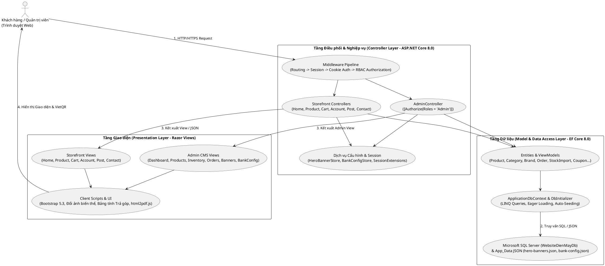

---

## 2. Hình 3.1 (Mục 3.2.1): Biểu đồ Use Case tổng quát của hệ thống Website Thương mại điện tử Điện Máy Xanh

### Cách 1: Dàn ngang toàn bộ khung hệ thống (`top to bottom direction` - Khách hàng ở trên, Khung Use Case trải ngang ở giữa, Admin ở dưới)

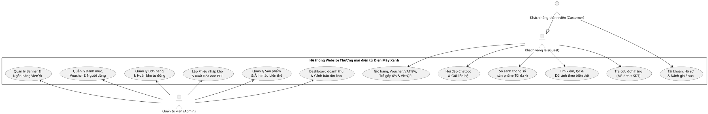

### Cách 2: Chia 2 khung Phân hệ Khách hàng (Trái) và Phân hệ Quản trị (Phải) nằm ngang cạnh nhau

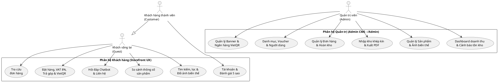

---

## 3. Hình 3.2 (Mục 3.2.1): Biểu đồ Use Case chi tiết Phân hệ Khách hàng (Storefront UX)

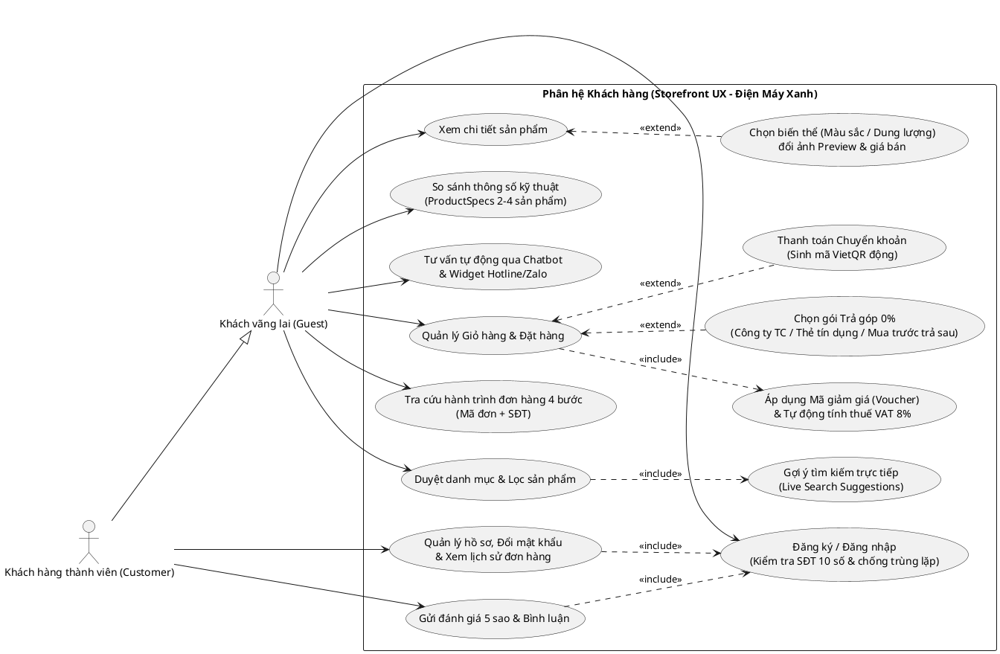

---

## 4. Hình 3.3 (Mục 3.2.1): Biểu đồ Use Case chi tiết Phân hệ Quản trị (Admin CMS)

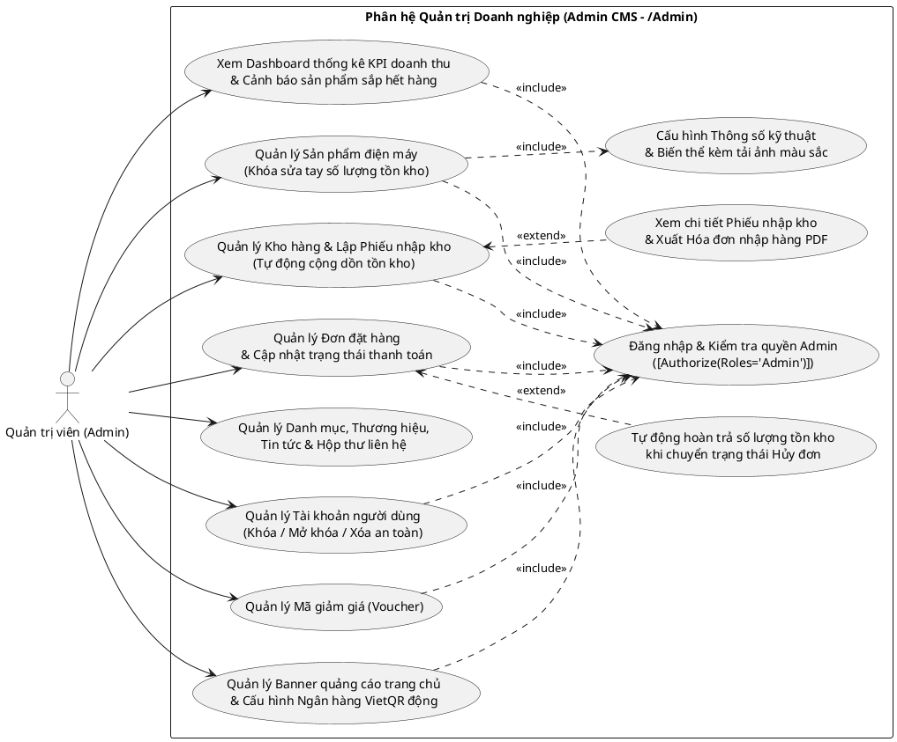

---

## 5. Hình 3.4 (Mục 3.2.3): Biểu đồ hoạt động quy trình Đặt hàng, áp dụng Mã giảm giá (Voucher), tính Trả góp 0% và VietQR động

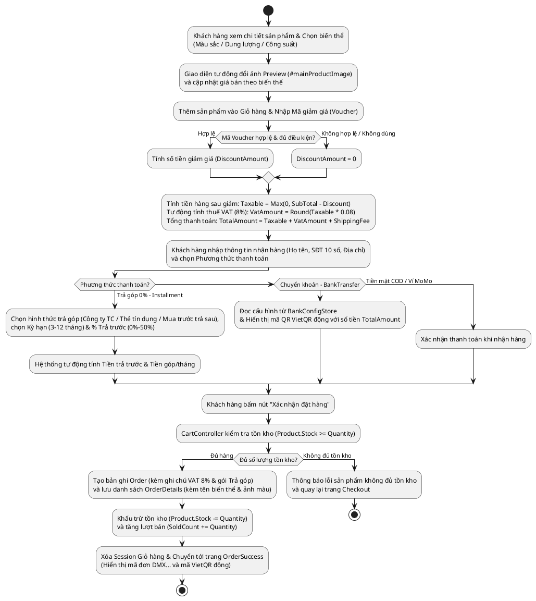

---

## 6. Hình 3.5 (Mục 3.2.3): Biểu đồ hoạt động quy trình Quản lý nhập kho khép kín (Khóa sửa tay tồn kho) và Xuất Phiếu nhập kho PDF

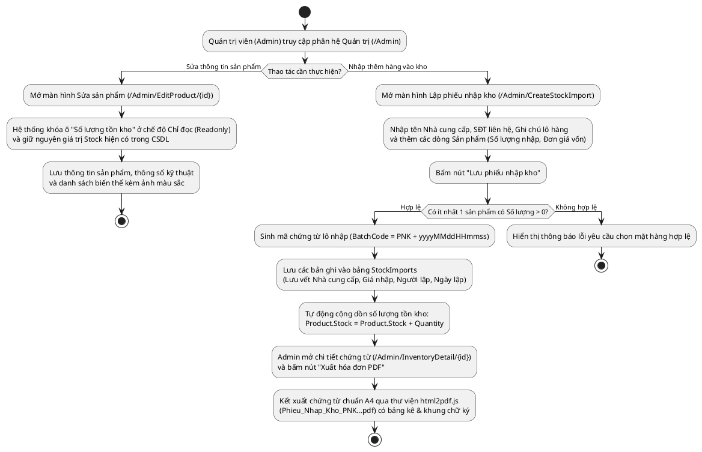

---

## 7. Hình 3.6 (Mục 3.2.4): Biểu đồ tuần tự xử lý đơn hàng, kiểm tra Voucher, tính thuế VAT 8% và đồng bộ tồn kho

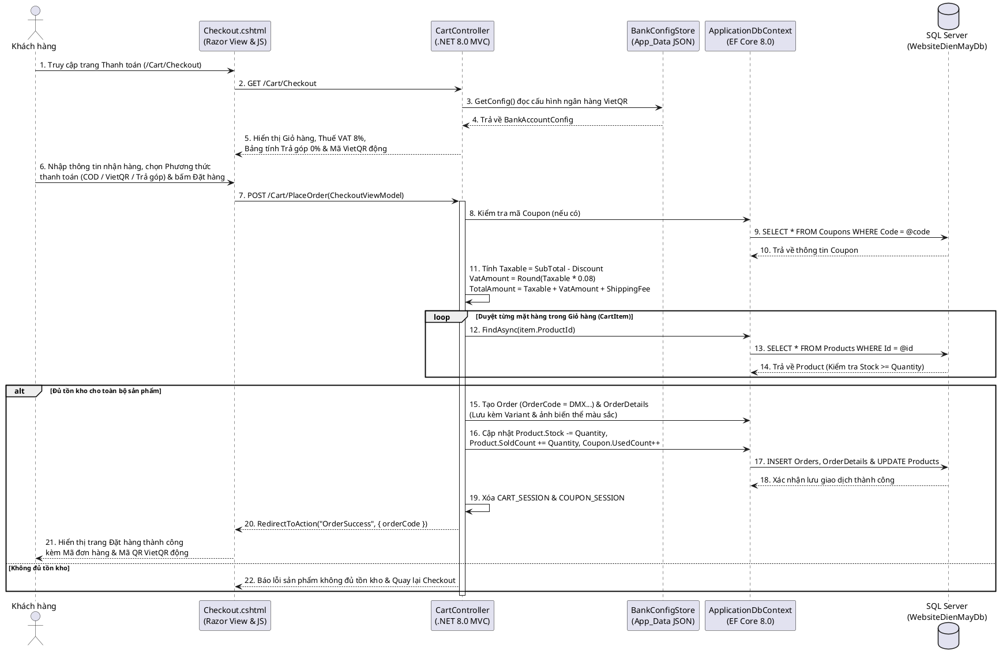

---

## 8. Hình 3.7 (Mục 3.2.5): Biểu đồ lớp (Class Diagram) của hệ thống Website Thương mại điện tử Điện Máy Xanh

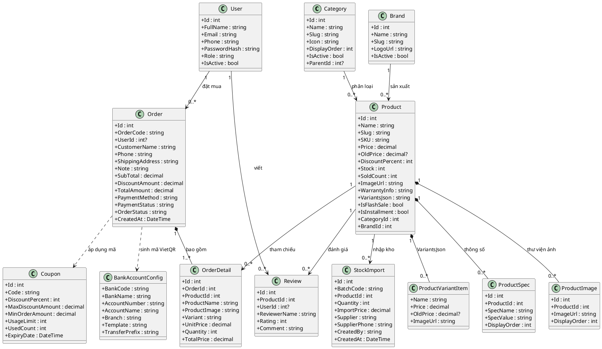

---

## 9. Hình 3.8 (Mục 3.3.1): Sơ đồ thực thể liên kết (ERD) cơ sở dữ liệu `WebsiteDienMayDb`

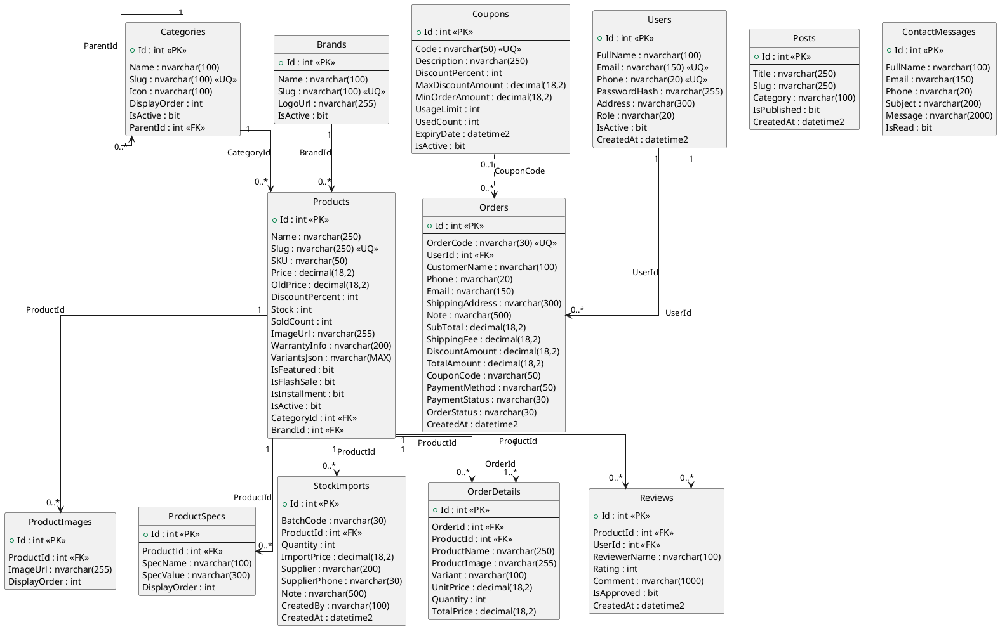

---

## 10. Hình 3.9 (Mục 3.5.1): Sơ đồ điều hướng tổng thể (Sitemap) của Storefront và Admin CMS

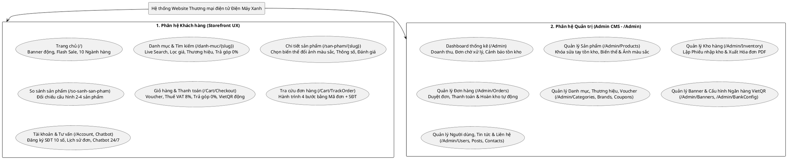
